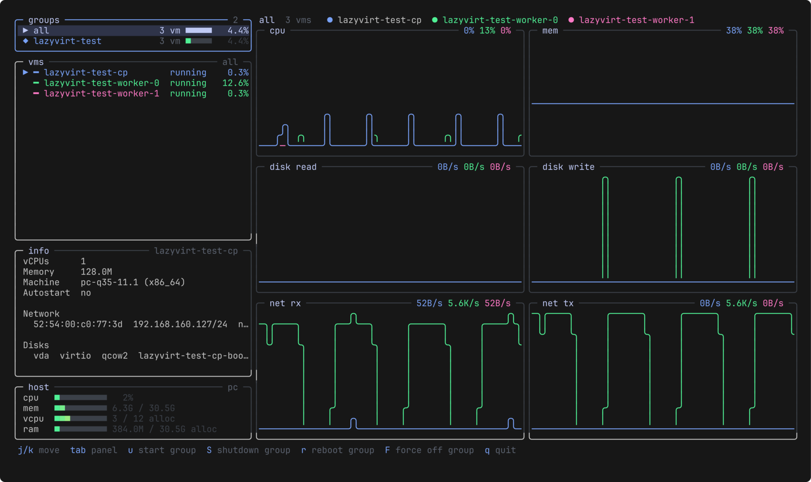
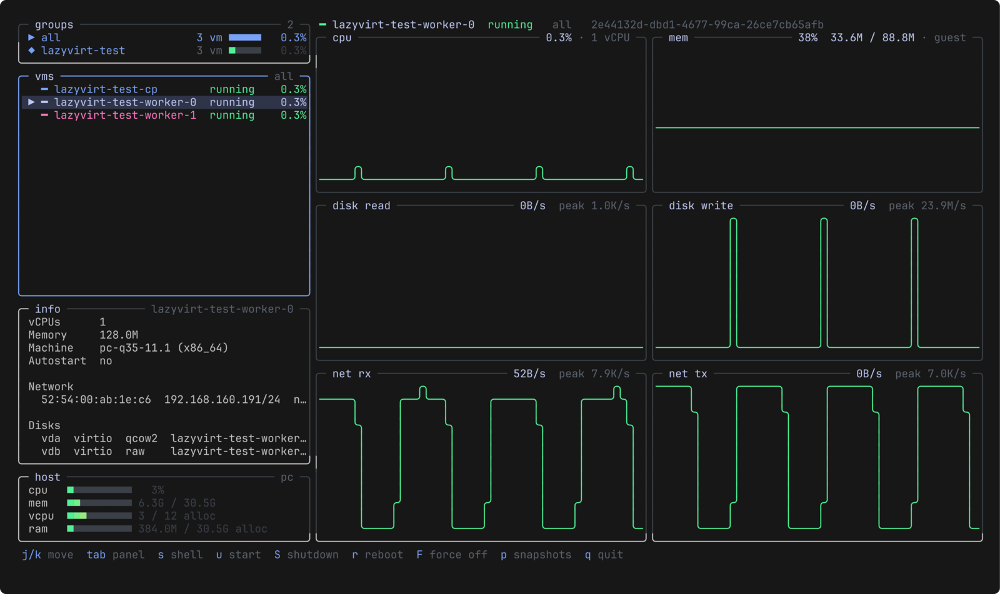
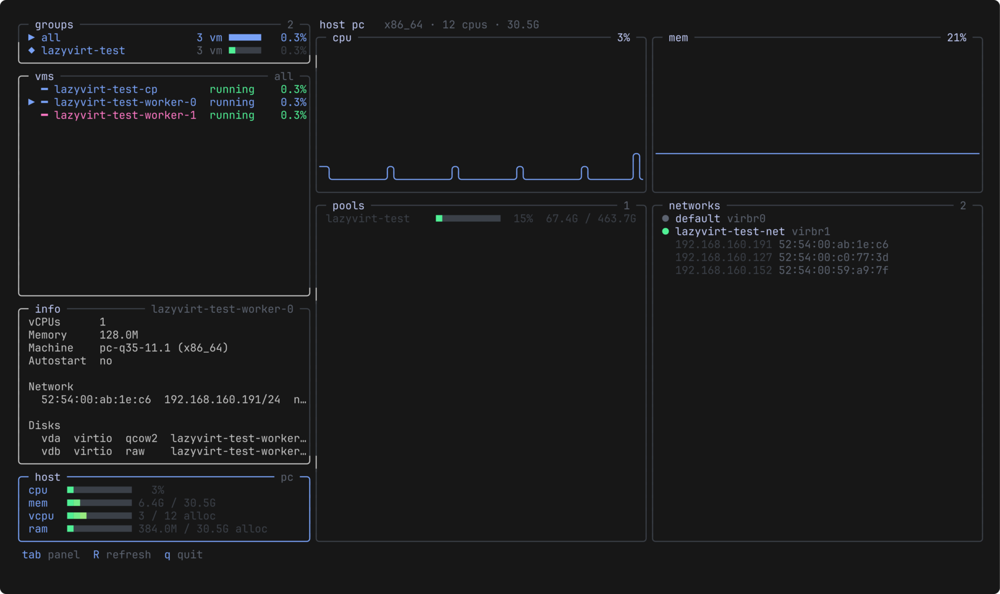

# lazyvirt

A [lazydocker](https://github.com/jesseduffield/lazydocker)-style terminal UI
for KVM/libvirt virtual machines. Watch CPU, memory, disk and network for
every VM at once, compare a group of VMs on the same charts, and start, stop,
snapshot or shell into them without leaving the terminal.



- **Groups.** VMs that share a name prefix (`talos-local-cp`,
  `talos-local-worker-0`, ...) form a group. Their metrics are overlaid on the
  same axes, so the odd one out stands out.
- **Live.** One `ConnectGetAllDomainStats` RPC per refresh covers every VM.
  State changes arrive as libvirt lifecycle events and show up at once.
- **Real guest memory.** Memory is what the guest reports as used, like
  `free`, not qemu's RSS on the host.
- **Actions.** Start, ACPI shutdown, reboot and force off one VM or a whole
  group. Create, revert and delete snapshots.
- **Shell.** `s` runs ssh to the VM's DHCP lease IP and falls back to the
  serial console.
- **Host.** Host CPU and memory, vCPUs and RAM claimed by VMs, storage pools
  and networks with their DHCP leases.
- **Local or remote.** `qemu:///system` or `qemu+ssh://user@host/system`.
  Pure Go, no cgo and no libvirt client library needed.

## Install

Prebuilt binaries for linux amd64 and arm64 are on the
[releases page](https://github.com/konkerama/lazyvirt/releases).

```bash
# with mise
mise use -g github:konkerama/lazyvirt

# with Go 1.27+
go install github.com/konkerama/lazyvirt/cmd/lazyvirt@latest
```

Each release has a `checksums.txt` and a build provenance attestation:

```bash
gh attestation verify lazyvirt_v0.1.0_linux_amd64.tar.gz -R konkerama/lazyvirt
```

### Requirements

- A running `libvirtd` (or the modular `virtqemud`) on the machine you
  connect to.
- Access to `qemu:///system` without sudo. On most distros that means being
  in the `libvirt` group: `sudo usermod -aG libvirt $USER`, then log in again.
- Optional: `ssh` and `virsh` on your `PATH` for the `s` shell key.

## Usage

```bash
lazyvirt                                   # qemu:///system (or $LIBVIRT_DEFAULT_URI)
lazyvirt --prefix talos-local              # only VMs whose name starts with this
lazyvirt -c qemu+ssh://user@host/system    # remote host
lazyvirt --interval 1s                     # refresh rate (default 2s)
lazyvirt --ssh-user ubuntu                 # user for the s key
lazyvirt --version
```

Remote `qemu+ssh` uses Go's ssh client: keys come from `~/.ssh/id_*` or the
agent, and host keys from `~/.ssh/known_hosts`. Aliases in `~/.ssh/config`
are not read, so give the real hostname and user.

### Keys

| Key | Action |
| --- | --- |
| `j`/`k`, arrows, `g`/`G` | move in the focused panel |
| `tab` / `shift+tab`, `h`/`l` | next / previous panel (`enter` vms, `esc` groups) |
| `s` | shell into the VM |
| `u` / `S` / `r` | start / ACPI shutdown / reboot |
| `F` | force off |
| `P` | pause / resume |
| `a` | toggle autostart on host boot (vms panel) |
| `p` | snapshots of the VM: `n` new, `enter` revert, `d` delete, `p` close |
| `/` | search VM names: `enter` keeps the filter, `esc` clears it |
| `R` | refresh now |
| `?` | help with every key |
| `q` | quit |

With the vms panel focused, `u`/`S`/`r`/`F`/`P` act on the selected VM (`F`
asks first). With the groups panel focused they act on the whole group: only
on the VMs the action applies to (start skips running ones, `P` pauses the
running ones, or resumes the paused ones if none is running), and always
after a y/n prompt with the count. The search narrows the groups too, so a
group action after `/worker` only hits the matching VMs. Errors from an action stay in the footer until the
next key.

## Views

There is one screen. The sidebar has four fixed panels: **groups**, the
selected group's **vms**, **info** for the selected VM, and **host**. `tab`
moves focus between groups, vms and host, and the charts on the right follow
the focus.

**Groups focused** (top screenshot): one colored line per VM of the group,
overlaid on shared axes for cpu, mem %, disk read/write and net rx/tx. The
selected VM's line is drawn on top. Groups are `all` plus one per name prefix
with 2 or more VMs: a trailing number and then the last segment are dropped,
so `talos-local-cp`, `talos-local-worker-0` and `talos-local-worker-1` form
`talos-local`.

**VMs focused:** the selected VM alone, with more detail in the titles: vCPUs,
used / total memory, current and peak rates. `p` replaces the disk and network
rows with the VM's snapshots.



**Host focused:** host CPU and memory history, storage pools with fill bars,
and networks with their DHCP leases.



## How it works

**Memory** is MemTotal minus MemAvailable as the guest reports it, the same
number `free` and btop show. To get fresh values, lazyvirt sets a balloon
stats period on each running VM. This is a live-only change: the saved domain
config is not touched, and the setting is gone when the VM stops. VMs without
a virtio balloon driver fall back to qemu's RSS on the host, labelled
`host rss`.

**IPs** in the info panel come from libvirt's DHCP leases. They need no guest
agent, but only show for VMs on a libvirt NAT network.

**Shell.** `s` runs `ssh <lease IP>`. `--ssh-user` sets the user; otherwise
your ssh config decides. For a `qemu+ssh://` URI the VM's network is on the
remote host, so ssh jumps through it (`-J user@host`). If ssh cannot connect
(exit 255: refused, timeout, unknown host key), lazyvirt opens the serial
console instead (`virsh console`; `Ctrl+]` returns to lazyvirt). VMs without
sshd, such as Talos nodes, always land on the console.

**Snapshots** are libvirt internal snapshots: the whole VM, with memory when it
is running. libvirt refuses them for VMs with a raw disk. lazyvirt shows that
error and does not fall back to external snapshots, because reverting those
leaves overlay files behind.

## Development

```bash
make test               # vet + unit tests, no libvirt needed
make vms-up             # tiny cirros VMs named lazyvirt-test-* (WORKERS=2)
make test-integration   # tests against those VMs
make run ARGS='--prefix lazyvirt-test'
make vms-down           # removes the test VMs, their pool and network
make bench              # per-tick parse and render cost
```

`make vms-up` only creates `lazyvirt-test-*` VMs in their own pool and NAT
network, so `make vms-down` cannot touch anything else.

### Releasing

```bash
git tag v0.1.0 && git push origin v0.1.0
```

The release workflow runs the tests, builds stripped static binaries for
linux amd64 and arm64, attests them and publishes a GitHub release with
generated notes.

## License

[MIT](LICENSE)
